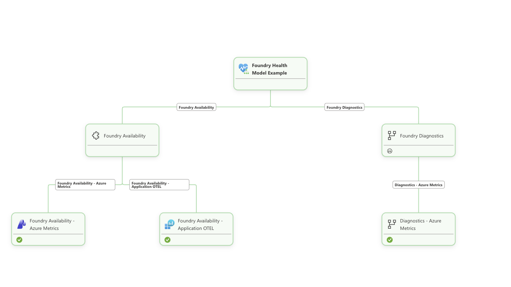
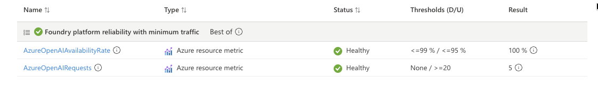

# Azure Monitor Health Model Guide for Microsoft Foundry

This repository demonstrates a reusable Azure Monitor Health Model for Microsoft Foundry. Direct Azure metrics provide the complete service-side baseline. An optional OpenTelemetry (OTEL) path enriches that baseline with a workload-observed perspective, while diagnostic anomalies remain separate from availability.

## Health Model structure

```text
Foundry Workload (99% health objective)
├── Foundry Availability
│   ├── Foundry Availability - Azure Metrics
│   └── Foundry Availability - Application OTEL
└── Foundry Diagnostics (suppressed)
    ├── Diagnostics - Azure Metrics
    └── Diagnostics - Synthetic Probe Job
```

The `Foundry-Example` Health Model contains the `Foundry Workload` root entity. Foundry Availability is the only branch that affects its 99% health objective and owns the Sev3/Sev2 alert policy. Diagnostics is suppressed from root health and doesn't generate alerts. All Foundry account metrics used for health evaluation are filtered to the configured model deployment with the `ModelDeploymentName` dimension.

The Application OTEL child is optional. A model that uses only Azure Metrics still provides gated availability and latency diagnostics; the reference deployment includes OTEL to demonstrate how workload telemetry can add context. Synthetic probe execution health is evaluated separately from Foundry service metrics.



## Signals

**Full catalog:** The [Azure OpenAI monitoring data reference](https://learn.microsoft.com/azure/foundry/openai/monitor-openai-reference#metrics) lists every available platform metric, including its REST API name, dimensions, supported aggregation, time grain, and diagnostic settings export support. The catalog covers multiple models, deployment types, and features, so not every metric is emitted by every Foundry resource.

The reference model uses nine health-state signals: six deployment-scoped Foundry platform metric signals, two optional OTEL signals, and one synthetic probe execution query:

| Entity | Technical signals | Purpose | Rollup |
| --- | --- | --- | --- |
| [Foundry Availability - Azure Metrics](infra/health-model-foundry-signals.bicep) | `AzureOpenAIAvailabilityRate`, `AzureOpenAIRequests` | Service-side availability gated by request volume | Foundry Availability, Sev3/Sev2 |
| [Foundry Availability - Application OTEL](infra/health-model-observability.bicep) (optional) | `foundry.availability_rate`, `foundry.requests` | Enriches service metrics with workload-observed availability using the same gate | Foundry Availability, Sev3/Sev2 |
| [Diagnostics - Azure Metrics](infra/health-model-observability.bicep) | `AzureOpenAINormalizedTBTInMS`, `AzureOpenAITTLTInMS`, `AzureOpenAINormalizedTTFTInMS`, plus an `AzureOpenAIRequests` traffic gate | Deployment-scoped latency anomalies gated by request volume | Foundry Diagnostics, suppressed, no alerts |
| [Diagnostics - Synthetic Probe Job](infra/health-model-observability.bicep) | Failed probe executions from `ContainerAppSystemLogs_CL` | Separates scheduled-job failures from Foundry metric behavior | Foundry Diagnostics, suppressed, no alerts |

### Recommended availability signal

Combine `AzureOpenAIAvailabilityRate` with `AzureOpenAIRequests` to avoid signal noise. Availability shows the percentage of calls that didn't return HTTP 5xx, while request count shows whether there is enough traffic to trust that percentage. Either metric alone is incomplete: availability can be noisy at low volume, and request count doesn't show whether calls succeeded.

Use a `BestOf` group as a minimum-traffic gate. Below 20 requests, the group stays Healthy; at 20 or more requests, it follows availability. Availability at or below 99% is Degraded with a Sev3 alert, and availability at or below 95% is Unhealthy with a Sev2 alert. Both metrics use a five-minute measurement window, refresh every minute, and filter `ModelDeploymentName` to the configured deployment.

Set a gate below the expected minimum traffic rather than equal to the average. This sample normally produces 25 synthetic requests per rolling five minutes and uses 20 so one missed or delayed one-minute probe execution doesn't leave the gate closed or stale. Production thresholds must be tuned from actual traffic, scheduling variance, and telemetry delay.

The Azure Metrics signals and `BestOf` group are defined in [`infra/health-model-foundry-signals.bicep`](infra/health-model-foundry-signals.bicep).



*The grouped view shows both the availability result and the request volume behind it.*

> **Other status codes:** To gate on responses such as 403, filter another `AzureOpenAIRequests` signal with `dimension: 'StatusCode'` and `dimensionFilter: '403'`, then combine it with the same minimum-request gate. Use KQL or OTEL instead when you need a percentage rather than a count.

### Why these signals

| Signal group | Why it was selected | Why it rolls up this way |
| --- | --- | --- |
| `AzureOpenAIAvailabilityRate` + `AzureOpenAIRequests` | Availability supplies the outcome, while request volume supplies its sample size. Together they distinguish a noisy percentage based on a few calls from a sustained reliability problem. | This is the clearest service-side reliability outcome, so it can affect availability and trigger Sev3/Sev2. |
| `foundry.requests` + `foundry.server_errors` (optional) | These counters reproduce the same request/HTTP 5xx calculation at the workload's logical-operation boundary. | Provides an alternative telemetry path that can enrich the service-side view. |
| Latency: `AzureOpenAINormalizedTTFTInMS`, `AzureOpenAINormalizedTBTInMS`, `AzureOpenAITTLTInMS` | Together they cover initial responsiveness, token-generation cadence, and completion time. Each captures a different part of perceived model latency. | Expected latency varies with model, streaming mode, prompt size, and generated output, so anomalies are diagnostic rather than direct availability failures. Each signal is paired with the diagnostic request-volume gate. |
| Tokens: `ProcessedPromptTokens`, `GeneratedTokens`, `TokenTransaction` | Input, output, and total inference-token volume explain workload shape, usage, cost, and whether latency changed with token volume. | Missed or delayed probe executions change five-minute totals even when service health is unchanged. Keep these metrics in workbooks and charts as context rather than Health Model outcomes. |
| Content safety: `RAIRejectedRequests`, `RAIHarmfulRequests`, `RAISystemEvent`, `RAITotalRequests` | These show blocked volume, detected harmful content, safety-system events, and the total volume checked. | A blocked request usually means a guardrail worked correctly, and zero-volume windows commonly remain `Unknown`. Keep these metrics in workbooks and charts rather than health-state signals. |
| Synthetic probe job failures | Container Apps system events identify `BackoffLimitExceeded`, failed executions, deadlines, and nonzero container termination separately from model telemetry. | A failed probe job is an execution-path diagnostic, not evidence of a Foundry metric anomaly, so it rolls up only through the suppressed Diagnostics branch. |

### Azure Metrics are the baseline; OTEL is optional enrichment

The model doesn't require OTEL. Direct Azure resource metrics are sufficient for Foundry availability and latency diagnostics. OTEL adds a second observation point when workload-level context is useful:

The optional OTEL queries and signal definitions are in [`infra/health-model-observability.bicep`](infra/health-model-observability.bicep).

| Path | Role | Observation point | Why use it | Trade-offs |
| --- | --- | --- | --- | --- |
| Azure resource metrics | Baseline | Foundry service | Lowest complexity; authoritative deployment-scoped request and latency telemetry; token and safety metrics remain available for charts | Limited to metrics and dimensions emitted for that Foundry deployment |
| OTEL through Application Insights and Log Analytics | Optional enrichment | Workload code | Adds logical-operation counting, portable semantics, customizable failure definitions, and correlation with other workload telemetry | Requires instrumentation, ingestion, query access, and tolerance for telemetry delay; can't recreate provider-only safety or system signals |

The reference deployment enables both paths so their availability results can be compared. The OTEL path records low-cardinality `foundry.requests` and `foundry.server_errors` counters once per logical Foundry operation, then queries `AppMetrics` over a completed, delayed five-minute window. This can expose differences in observation boundaries and connect Foundry health to the rest of the workload's telemetry.

OTEL intentionally mirrors only request volume and HTTP 5xx availability in this sample. Latency diagnostics continue to use direct Azure metrics, while token and content-safety metrics are chart context rather than Health Model signals. If the extra workload perspective isn't needed, omit the Application OTEL child and retain the Azure Metrics branch unchanged. When using OTEL, keep attributes low-cardinality and exclude prompt text, response content, and user identifiers.

For private OTEL ingestion and Health Model query access, see the [AMPLS recommendation for Health Models and OpenTelemetry metrics](docs/ampls-health-model-otel-recommendation.md).

### Diagnostics and dynamic thresholds

Only the three latency diagnostics use low-sensitivity dynamic thresholds. They share a 20-request `AzureOpenAIRequests` gate with a five-minute measurement window and one-minute refresh. Below that volume, each `BestOf` group stays Healthy instead of treating sparse or missing traffic as an anomaly. At 20 or more requests, the group follows the dynamic latency signal.

The synthetic probe job uses a separate static Log Analytics signal. Its KQL evaluates a completed five-minute window delayed by two minutes, filters to the configured job name, de-duplicates terminal failure events by execution, and returns zero when none are found. `BackoffLimitExceeded`, explicit failed/deadline events, and container termination with a nonzero exit code make the signal Unhealthy.

The diagnostic metric signals and dynamic-threshold rules are defined in [`infra/health-model-observability.bicep`](infra/health-model-observability.bicep).

| Signal status | Meaning |
| --- | --- |
| Numeric value and `Healthy` or `Unhealthy` during warm-up | Azure is using in-place statistical evaluation until enough history is available for the learned baseline |
| No value, `Unknown`, and no error | The metric produced no sample in the evaluation window or isn't emitted by that deployment |
| `Unknown` with an error | The metric name, query, permissions, or data source configuration failed |

Allow several days of representative traffic before interpreting a new dynamic signal's state. Warm-up doesn't guarantee an `Unknown` state because Health Models temporarily evaluate the available samples statistically. Because Diagnostics is suppressed, ignores unknown children, and has no alert policy, its states remain investigation context only.

## Health Model templates

| Template | Purpose |
| --- | --- |
| [`infra/health-model-metrics.bicep`](infra/health-model-metrics.bicep) | Grants the Health Model identity access to Azure metrics and Log Analytics |
| [`infra/health-model-foundry-signals.bicep`](infra/health-model-foundry-signals.bicep) | Configures gated Azure Metrics availability on the Foundry entity |
| [`infra/health-model-observability.bicep`](infra/health-model-observability.bicep) | Creates the Availability and suppressed Diagnostics hierarchy, OTEL availability, latency diagnostics, probe execution diagnostics, relationships, and Availability alerts |

## References

- [Azure OpenAI monitoring data reference](https://learn.microsoft.com/azure/foundry/openai/monitor-openai-reference)
- [Azure Monitor Health Model concepts](https://learn.microsoft.com/azure/azure-monitor/health-models/concepts)
- [Configure signals in Azure Monitor Health Models](https://learn.microsoft.com/azure/azure-monitor/health-models/signals)

## Reproduce this example

To reproduce the Health Model and its telemetry, deploy the included example workload by following [`DEPLOYMENT.md`](DEPLOYMENT.md).

The deployment also includes a synthetic Foundry probe that sends five low-token requests per minute. Its approximately 25 requests per five-minute window intentionally open the 20-request platform and diagnostic gates, but don't increment the optional Application OTEL counters. The Health Model tracks probe job execution failures separately so scheduling or container failures don't masquerade as Foundry metric anomalies. At the observed token mix, the model requests cost about $47.65 per 30-day month, plus Container Apps execution and logging costs.
